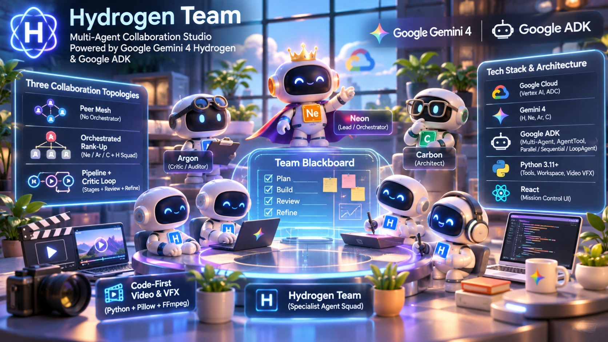
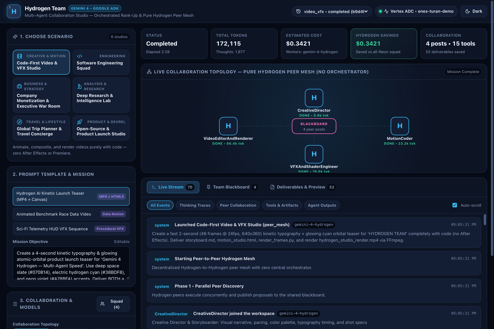
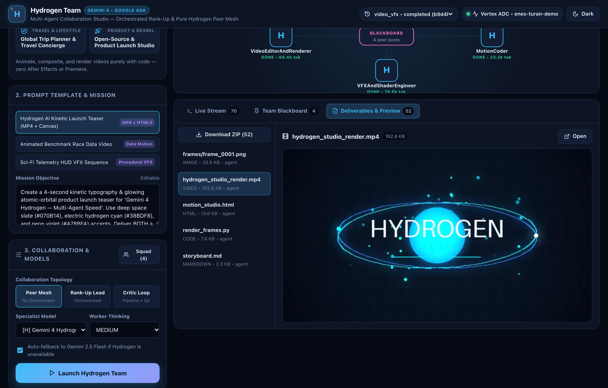
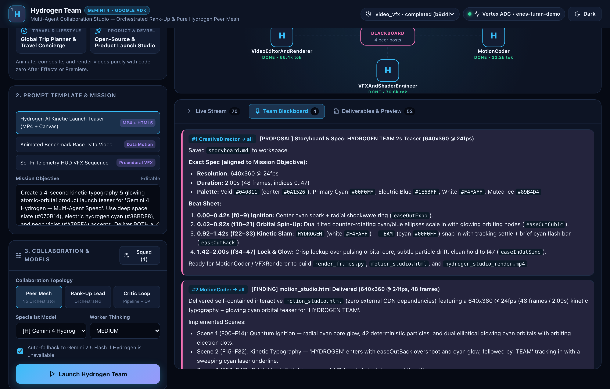
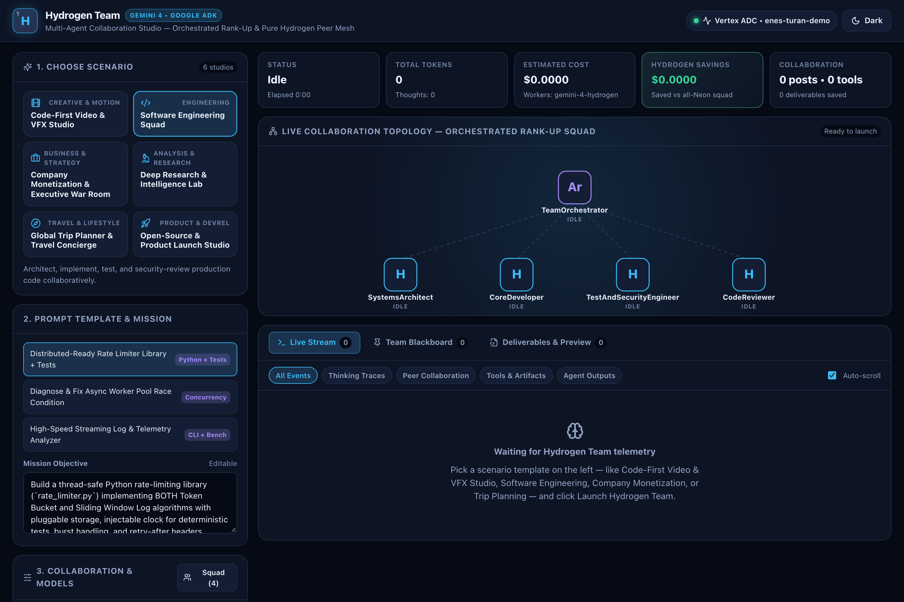
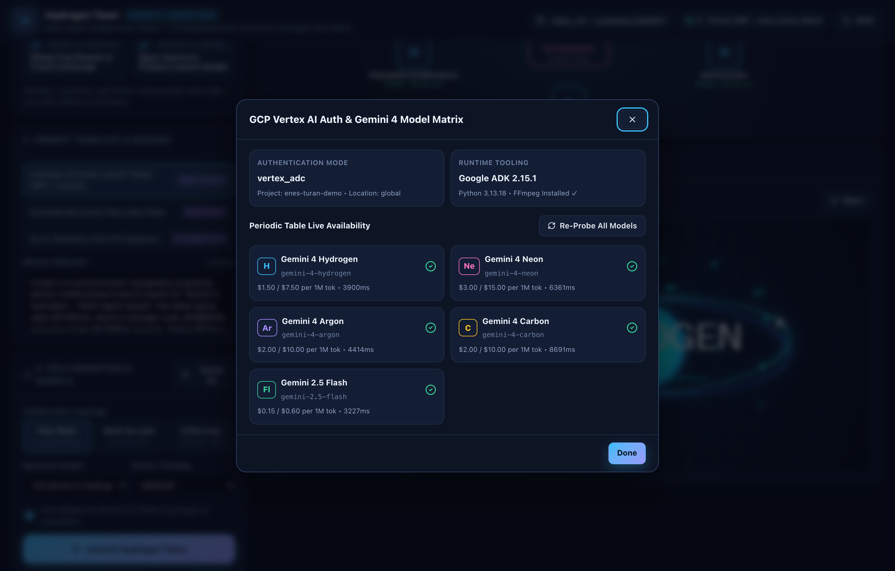
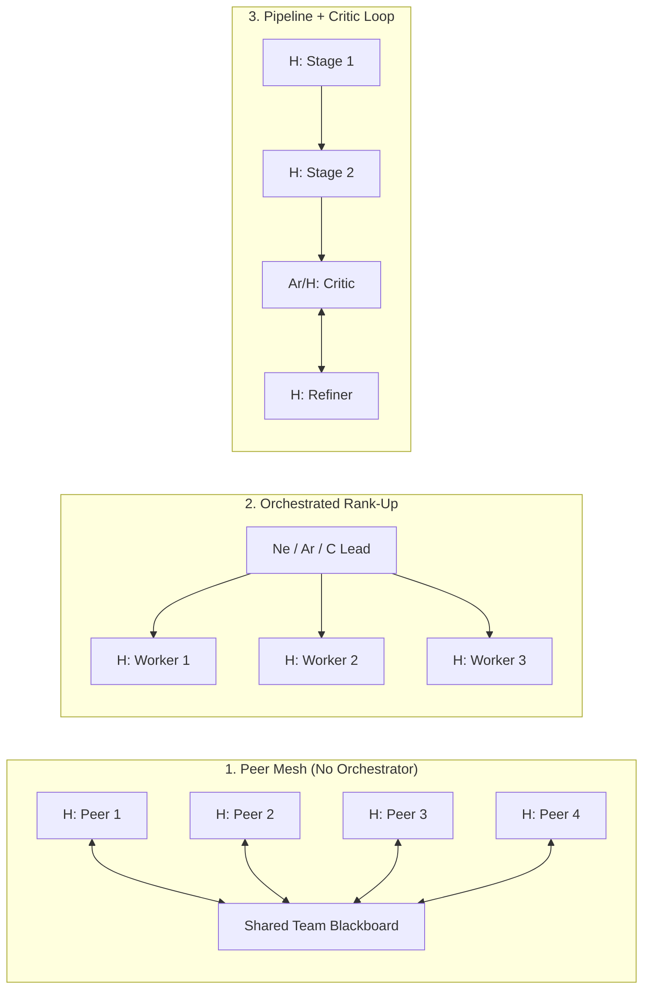

<div align="center">



# Hydrogen Team

**Open-source multi-agent collaboration studio powered by Google Gemini 4 Hydrogen (`gemini-4-hydrogen`) & Google ADK**

[](LICENSE)
[](pyproject.toml)
[](https://google.github.io/adk-docs/)
[](#quick-start)

[Quick Start](#quick-start) · [Screenshots](#mission-control-ui) · [Scenarios](#scenarios--templates) · [Architecture](docs/ARCHITECTURE.md) · [Contributing](CONTRIBUTING.md)

</div>

---

**Hydrogen Team** showcases teams of fast, low-cost **Gemini 4 Hydrogen** agents solving problems together — either in a **decentralized Peer-to-Peer Mesh (no orchestrator)** or guided by a **higher-rank Gemini 4 lead (`Neon`, `Argon`, or `Carbon`)** — with live thinking traces, a shared Team Blackboard, sandboxed execution, and **code-first MP4 video & VFX rendering (zero After Effects or Premiere)**.

- **Zero-Key Auth:** Auto-detects your Google Cloud ADC (`gcloud`) and Vertex AI `global` endpoint, with automatic fallback to `gemini-2.5-flash`.
- **Live Mission Control UI:** Watch animated Periodic-Table agent graphs, Gemini 4 reasoning traces, token savings, and live MP4 / HTML5 previews over SSE.
- **6 Built-In Studios (18 Templates):** Video & VFX, Software Engineering, Company Monetization, Deep Research, Global Trip Planning, and Product Launch.

---

## Mission Control UI



<details>
<summary><strong>More Screenshots — Video Preview, Team Blackboard, Rank-Up Topology &amp; Model Matrix</strong></summary>

<br />

| Code-First Video &amp; VFX Preview (`MP4`) | Shared Team Blackboard (`Peer Handoffs`) |
| :---: | :---: |
|  |  |

| Orchestrated Rank-Up (`Argon` + `Hydrogen`) | GCP Vertex AI Auth &amp; Gemini 4 Model Matrix |
| :---: | :---: |
|  |  |

</details>

---

## Quick Start

> **Prerequisite:** Python 3.11+, [`uv`](https://docs.astral.sh/uv/), Node.js 20+, optional `ffmpeg` (for MP4 rendering), and GCP ADC (`gcloud auth application-default login`).

```bash
git clone https://github.com/devenes/gemini-hydrogen-team.git && cd gemini-hydrogen-team
uv venv --python 3.13 .venv && source .venv/bin/activate
uv pip install -e ".[dev]" && (cd web && npm install && npm run build)

hydrogen-team doctor   # Verify Vertex AI ADC & probe Gemini 4 models
hydrogen-team web      # Launch Mission Control UI at http://127.0.0.1:8042
```

<details>
<summary><strong>CLI Missions, Native Google ADK Web UI &amp; Optional API Key Setup</strong></summary>

```bash
# List all 6 scenarios & 18 starter templates
hydrogen-team scenarios

# Run Code-First Video & VFX Studio in Pure Hydrogen Peer Mesh (no orchestrator)
hydrogen-team run --scenario video_vfx --template 0 --mode peer_mesh

# Run Company Monetization War Room with Gemini 4 Carbon orchestrating Hydrogen workers
hydrogen-team run --scenario company_ops --template 0 --mode orchestrated --orchestrator-model gemini-4-carbon

# Run Trip Planner with a custom prompt
hydrogen-team run --scenario trip_planning --mode peer_mesh \
  --prompt "Plan a 4-day culinary & architecture trip to Lisbon for 2 under $2,000 with trip_guide.html"

# Launch Google ADK's built-in developer UI pointed at adk_agents/
hydrogen-team adk-web --scenario coding --mode orchestrated
```

**Using a Gemini API Key instead of GCP ADC?** Copy `.env.example` to `.env`, set `GOOGLE_GENAI_USE_VERTEXAI=FALSE`, and set `GEMINI_API_KEY=...`. If your key lacks Gemini 4 access, **Auto-Fallback** automatically switches to `gemini-2.5-flash` with a live UI notice.

</details>

---

## Gemini 4 Periodic Table & Topologies

<details>
<summary><strong>Model Lineup — Pricing, Ranks &amp; Thinking Levels (H, Ne, Ar, C, Fl)</strong></summary>

<br />

| Element | Model ID | Rank / Ideal Role | Pricing (In / Out per 1M) | Thinking Levels |
| :--- | :--- | :--- | :---: | :--- |
| **1 `H`** | `gemini-4-hydrogen` | **Specialist Squad** — fast coding, VFX, research, planning | \$1.50 / \$7.50 | `MINIMAL` `LOW` `MEDIUM` `HIGH` `XHIGH` |
| **10 `Ne`** | `gemini-4-neon` | **Balanced Lead** — frontier synthesis &amp; delegation | \$3.00 / \$15.00 | `LOW` `MEDIUM` `HIGH` `XHIGH` |
| **18 `Ar`** | `gemini-4-argon` | **Deep Critic / Lead** — token-efficient frontier reasoner | \$2.00 / \$10.00 | `LOW` `MEDIUM` `HIGH` |
| **6 `C`** | `gemini-4-carbon` | **Flagship Architect** — maximum depth for high-stakes strategy | \$2.00 / \$10.00 | `LOW` `MEDIUM` `HIGH` |
| **25 `Fl`** | `gemini-2.5-flash` | **Auto-Fallback** — activates seamlessly if Gemini 4 is disabled | \$0.15 / \$0.60 | `LOW` `MEDIUM` `HIGH` |

</details>

<details>
<summary><strong>Three Google ADK Collaboration Topologies — Peer Mesh, Rank-Up &amp; Critic Loop</strong></summary>



1. **Peer Mesh (`peer_mesh`):** Pure Hydrogen-to-Hydrogen collaboration via ADK `ParallelAgent` + `SequentialAgent` and the shared Team Blackboard.
2. **Orchestrated Rank-Up (`orchestrated`):** A higher-rank lead delegates to Hydrogen specialists via ADK `AgentTool`, with nested sub-agent telemetry captured live by `HydrogenTelemetryPlugin`.
3. **Pipeline + Critic Loop (`pipeline_loop`):** Sequential Hydrogen stages feeding into an ADK `LoopAgent` quality gate (`exit_loop`).

</details>

---

## Scenarios & Templates

<details open>
<summary><strong>6 Built-In Multi-Agent Studios (Customizable in UI Squad Editor)</strong></summary>

<br />

| Scenario | ID | Key Deliverables |
| :--- | :--- | :--- |
| **Code-First Video &amp; VFX Studio** | `video_vfx` | `storyboard.md`, `render_frames.py`, FFmpeg `hydrogen_studio_render.mp4`, interactive `motion_studio.html` |
| **Software Engineering Squad** | `coding` | `ARCHITECTURE.md`, typed Python modules, live-executed `test_solution.py`, `REVIEW.md` |
| **Company Monetization War Room** | `company_ops` | Unit-economics simulation, `financial_projection.csv`, `gtm_playbook.md`, `executive_dashboard.html` |
| **Deep Research &amp; Intelligence Lab** | `research` | `research_notes.md`, `analysis.py`, `peer_review.md`, `research_report.md`, `research_brief.html` |
| **Global Trip Planner &amp; Concierge** | `trip_planning` | `final_itinerary.md`, `budget_breakdown.csv`, `local_gems.md`, interactive `trip_guide.html` |
| **Open-Source &amp; Product Launch** | `product_launch` | `positioning.md`, `quickstart.md`, `launch_page.html`, `launch_plan.md` |

</details>

---

## Architecture, Safeguards & Development

<details>
<summary><strong>Timeout &amp; Resilience Safeguards, Project Tree &amp; Test Commands</strong></summary>

<br />

- **Bounded Timeouts:** Per-call `HttpOptions(timeout=HYDROGEN_LLM_TIMEOUT_MS)` (`60s` default, 2 retry attempts) on all `LlmAgent`s + `RunConfig`, plus `asyncio.wait_for(..., timeout=HYDROGEN_RUN_TIMEOUT_SECONDS)` (`240s` default) and `HYDROGEN_MAX_LLM_CALLS=40`.
- **Sandboxed Execution:** All agent file I/O is confined inside `runs/<run_id>/workspace/` via canonical path validation, with subprocess timeouts on Python (`5–90s`) and FFmpeg (`60s`).
- **Deep Dive:** Full sequence diagrams and module details in [docs/ARCHITECTURE.md](docs/ARCHITECTURE.md).

```text
gemini-hydrogen-team/
├── src/hydrogen_team/   # config, models, events, workspace, tools, scenarios, topologies, engine, server, cli
├── adk_agents/          # Native Google ADK (`adk web` / `adk run`) entry point
├── docs/                # ARCHITECTURE.md & UI screenshots
├── web/                 # React + TypeScript Mission Control UI
└── tests/               # Unit, API, sandbox & live Vertex AI integration tests
```

```bash
ruff check src tests        # Lint Python
pytest -m "not live"        # Fast offline unit & API suite
pytest -m live -s           # Live Vertex AI Gemini 4 multi-agent tests
cd web && npm run dev       # Frontend HMR dev server (proxies /api to :8042)
```

</details>

---

<div align="center">

Licensed under the [Apache License 2.0](LICENSE) · See [CONTRIBUTING.md](CONTRIBUTING.md) &amp; [SECURITY.md](SECURITY.md)

<sub>Built on <strong>Google Antigravity</strong> · Powered by <strong>Gemini 4 Hydrogen</strong>, <strong>Google ADK</strong>, and <strong>Google Cloud Vertex AI</strong></sub>

</div>
