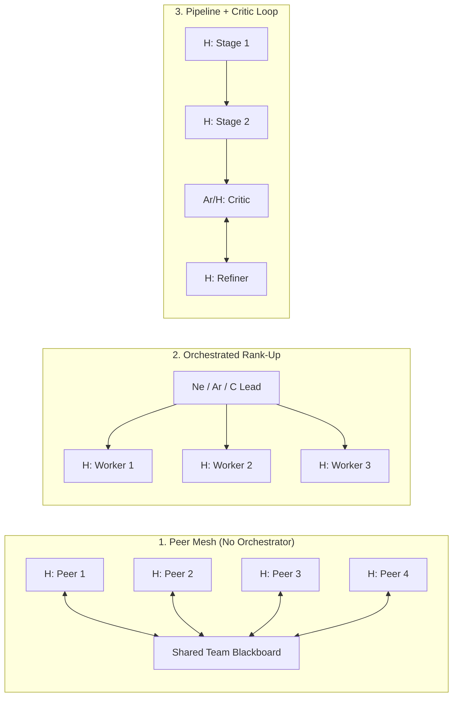

# Hydrogen Team

**Open-source multi-agent collaboration studio built on Google Gemini 4 Hydrogen (`gemini-4-hydrogen`) and Google ADK.**

[](LICENSE)
[](pyproject.toml)
[](https://google.github.io/adk-docs/)
[](#quick-start-zero-api-key)

Hydrogen Team demonstrates what happens when fast, cost-efficient **Gemini 4 Hydrogen** agents work together — either in a **decentralized Peer-to-Peer Mesh (no orchestrator)** or led by a **higher-rank Gemini 4 orchestrator (`Neon`, `Argon`, or `Carbon`)** — solving real-world problems with live visible thinking traces, peer-to-peer blackboard collaboration, code execution, financial modeling, and **code-first MP4 video & VFX rendering with zero After Effects or Premiere**.

---

## Why Hydrogen Team?

Running every agent on a heavy frontier model is slow and expensive. **Gemini 4 Hydrogen** (`gemini-4-hydrogen`) unlocks a new architecture: teams of fast, specialized agents collaborating transparently over a shared Team Blackboard and sandboxed workspace, optionally paired with a higher-rank **Neon**, **Argon**, or **Carbon** lead.

### The Gemini 4 Periodic Table in Hydrogen Team

| Element | Model ID | Rank / Ideal Role | Pricing (In / Out per 1M) | Thinking Levels |
| :--- | :--- | :--- | :---: | :--- |
| **1 `H`** | `gemini-4-hydrogen` | **Default Specialist Squad** — fast execution, coding, VFX, research | \$1.50 / \$7.50 | `MINIMAL`, `LOW`, `MEDIUM`, `HIGH`, `XHIGH` |
| **10 `Ne`** | `gemini-4-neon` | **Rank-Up Orchestrator** — balanced frontier synthesis & delegation | \$3.00 / \$15.00 | `LOW`, `MEDIUM`, `HIGH`, `XHIGH` |
| **18 `Ar`** | `gemini-4-argon` | **Deep Critic & Auditor** — token-efficient frontier reasoning | \$2.00 / \$10.00 | `LOW`, `MEDIUM`, `HIGH` |
| **6 `C`** | `gemini-4-carbon` | **Flagship Architect** — maximum depth for high-stakes strategy | \$2.00 / \$10.00 | `LOW`, `MEDIUM`, `HIGH` |
| **25 `Fl`** | `gemini-2.5-flash` | **Automatic Fallback** — activates seamlessly if Hydrogen isn't enabled yet | \$0.15 / \$0.60 | `LOW`, `MEDIUM`, `HIGH` |

---

## Three Multi-Agent Collaboration Topologies (Built with Google ADK)



1. **Peer Mesh (`peer_mesh` — No Orchestrator):** Pure Hydrogen-to-Hydrogen collaboration using ADK `ParallelAgent` (concurrent discovery) followed by `SequentialAgent` (cross-review, build, and collective assembly via the shared Team Blackboard).
2. **Orchestrated Rank-Up (`orchestrated`):** A higher-rank lead (`gemini-4-neon`, `gemini-4-argon`, `gemini-4-carbon`, or `gemini-4-hydrogen`) decomposes the objective and delegates via ADK `AgentTool` to Hydrogen specialists while streaming every nested sub-agent thought and tool call live through a custom ADK `BasePlugin`.
3. **Assembly Pipeline + Critic Loop (`pipeline_loop`):** Sequential Hydrogen stages feeding into an ADK `LoopAgent` quality gate (`exit_loop`) where a critic reviews workspace artifacts and requests targeted refinements.

For a deep dive into the routing, ADK topologies, telemetry plugin, timeout safeguards, and video pipeline, see [docs/ARCHITECTURE.md](docs/ARCHITECTURE.md).

---

## Timeout, Resilience & Fallback Safeguards

Multi-agent runs involving nested `AgentTool` delegations, reasoning traces, and subprocess tool calls are protected at three layers so a stalled model call never hangs the UI or runner indefinitely:

- **Per-Call HTTP Timeout & Retries (`HYDROGEN_LLM_TIMEOUT_MS=60000`):** Applied via `google.genai.types.HttpOptions(timeout=..., retry_options=HttpRetryOptions(attempts=2))` on `GenerateContentConfig` for both specialist `LlmAgent`s and `TeamOrchestrator` (so nested `AgentTool` calls enforce the same per-request deadline) as well as ADK `RunConfig`.
- **Run-Level Deadline (`HYDROGEN_RUN_TIMEOUT_SECONDS=240`):** Wraps `Runner.run_async(...)` in `asyncio.wait_for(...)`. If exceeded, `RunManager` cleanly marks the run `failed`, emits an `error` `TeamEvent` and UI alert banner, persists `metadata.json`, and closes active SSE streams.
- **LLM Call Cap & Subprocess Bounds:** `HYDROGEN_MAX_LLM_CALLS=40` caps total ADK model turns per run; `run_python_script` (5–90s) and `render_video_from_frames` (60s) enforce strict subprocess timeouts.
- **Automatic Model Fallback:** Before launching a topology, `resolve_model_with_fallback()` live-probes the requested worker/orchestrator model (cached for 300s) and seamlessly falls back to `HYDROGEN_FALLBACK_MODEL` (`gemini-2.5-flash`) with a `fallback_notice` event if Gemini 4 is unavailable on the active project or API key.

See [docs/ARCHITECTURE.md](docs/ARCHITECTURE.md) for sequence diagrams and implementation details.

---

## Built-In Scenarios & Starter Templates

Every scenario ships with 4 specialized agents, tailored sandboxed tools, and 3 one-click starter prompt templates (plus full **Custom Squad** editing in the UI):

| Scenario | ID | Highlights & Real Deliverables |
| :--- | :--- | :--- |
| **Code-First Video & VFX Studio** | `video_vfx` | Zero After Effects/Premiere: writes Python+Pillow procedural animations, renders real H.264 `.mp4` videos via FFmpeg with ambient audio, AND builds an interactive HTML5 Canvas timeline player (`motion_studio.html`). |
| **Software Engineering Squad** | `coding` | Architectures, implements typed Python code, writes & **executes live `unittest` suites**, and produces security/complexity code reviews. |
| **Company Monetization & Executive War Room** | `company_ops` | Runs deterministic unit-economics simulations (LTV, CAC, payback, 12-36m ARR), exports CSV models, GTM playbooks, and an interactive `executive_dashboard.html`. |
| **Deep Research & Intelligence Lab** | `research` | Hypothesis framing, Python quantitative modeling, adversarial peer critique, and publication-grade `research_brief.html`. |
| **Global Trip Planner & Concierge** | `trip_planning` | Realistic day-by-day route clustering, itemized CSV budgets, neighborhood food gems, rain-day backups, and an interactive `trip_guide.html`. |
| **Open-Source & Product Launch Studio** | `product_launch` | Positioning, developer quickstarts, self-contained interactive `launch_page.html` microsites, and launch-day playbooks. |

---

## Quick Start (Zero API Key)

Hydrogen Team automatically detects your **Google Cloud Application Default Credentials (ADC)** and active `gcloud` project, targeting Vertex AI's `global` endpoint where Gemini 4 models live — **no Gemini API key required**.

### Prerequisites

- Python 3.11+ (3.13 recommended) and [`uv`](https://docs.astral.sh/uv/) (or `pip`)
- Node.js 20+ (only needed to build/modify the custom Mission Control UI)
- Google Cloud CLI authenticated once:
  ```bash
  gcloud auth application-default login
  gcloud config set project YOUR_GCP_PROJECT_ID
  ```
- Optional: `ffmpeg` installed (`brew install ffmpeg` / `apt install ffmpeg`) for live `.mp4` video rendering in the Video & VFX Studio.

### 1. Install & Build

```bash
git clone https://github.com/your-org/hydrogen-team.git
cd hydrogen-team

# Create virtual environment and install Hydrogen Team
uv venv --python 3.13 .venv
source .venv/bin/activate
uv pip install -e ".[dev]"

# Build the custom Mission Control Web UI
cd web && npm install && npm run build && cd ..
```

### 2. Verify GCP Auth & Probe Gemini 4 Models

```bash
hydrogen-team doctor
```

This checks your Vertex AI ADC credentials, active project, `global` endpoint, FFmpeg availability, and live-probes `gemini-4-hydrogen`, `gemini-4-neon`, `gemini-4-argon`, `gemini-4-carbon`, and `gemini-2.5-flash`.

> **Using a Gemini API Key instead of GCP ADC?**
> Copy `.env.example` to `.env`, set `GOOGLE_GENAI_USE_VERTEXAI=FALSE`, and set `GEMINI_API_KEY=...`. If your account doesn't have Gemini 4 access yet, leave **Auto-Fallback** enabled and Hydrogen Team will automatically switch to `gemini-2.5-flash` with a visible notice.

### 3. Launch Mission Control Web UI

```bash
hydrogen-team web
```

Open **[http://127.0.0.1:8042](http://127.0.0.1:8042)** to watch:
- **Live Periodic-Table Collaboration Graph** with animated message beams
- **Real-Time Gemini 4 Thinking Traces** (`LOW` / `MEDIUM` / `HIGH` / `XHIGH`)
- **Team Blackboard** showing peer proposals, critiques, and handoffs
- **Token & Hydrogen Cost Savings Telemetry** compared against an all-Neon squad
- **Deliverables & Live Preview** with embedded `<video>` MP4 playback and sandboxed live HTML5 previews

### 4. Or Run From the Terminal CLI

```bash
# List all 6 scenarios & starter templates
hydrogen-team scenarios

# Run Code-First Video & VFX Studio in Pure Hydrogen Peer Mesh mode
hydrogen-team run --scenario video_vfx --template 0 --mode peer_mesh

# Run Company Monetization War Room with Gemini 4 Carbon orchestrating Hydrogen workers
hydrogen-team run --scenario company_ops --template 0 --mode orchestrated --orchestrator-model gemini-4-carbon

# Run Trip Planner with a custom prompt
hydrogen-team run --scenario trip_planning --mode peer_mesh \
  --prompt "Plan a 4-day culinary & architecture trip to Lisbon for 2 under $2,000 with trip_guide.html"
```

### 5. Or Launch Native Google ADK Web UI

Hydrogen Team also ships a standard Google ADK agent package in [`adk_agents/hydrogen_team/`](adk_agents/hydrogen_team/agent.py):

```bash
hydrogen-team adk-web --scenario coding --mode orchestrated
# Or directly via ADK CLI:
adk web adk_agents
```

---

## Project Architecture

```text
hydrogen-team/
├── src/hydrogen_team/
│   ├── config.py        # Zero-key Vertex AI ADC auto-detection & settings
│   ├── models.py        # Gemini 4 Periodic Table registry, live probing & fallback
│   ├── events.py        # Structured telemetry events & Hydrogen cost savings tracker
│   ├── workspace.py     # Sandboxed per-run workspace, Blackboard, ZIP exporter
│   ├── tools.py         # ADK tools: Blackboard, workspace files, Python runner, FFmpeg renderer, finance modeler
│   ├── scenarios.py     # 6 scenarios × 3 starter prompt templates
│   ├── topologies.py    # ADK ParallelAgent / SequentialAgent / LoopAgent / AgentTool graphs
│   ├── engine.py        # ADK BasePlugin live telemetry + SSE pub/sub RunManager
│   ├── server.py        # FastAPI REST + SSE streaming + artifact & video server
│   └── cli.py           # Typer + Rich CLI (`doctor`, `scenarios`, `models`, `run`, `web`, `adk-web`)
├── adk_agents/          # Native Google ADK `adk web` / `adk run` compatibility
├── docs/                # Technical architecture & Mermaid diagrams (ARCHITECTURE.md)
├── web/                 # Custom React + TypeScript Mission Control Web UI
└── tests/               # Unit, API, security sandbox & live Vertex AI integration tests
```

---

## Development & Testing

```bash
# Run fast unit & API test suite (no external cloud calls)
pytest -m "not live"

# Run live Vertex AI Gemini 4 Hydrogen multi-agent integration tests
pytest -m live -s

# Lint Python
ruff check src tests

# Frontend dev server with HMR (proxies /api to :8042)
cd web && npm run dev
```

Or use the included `Makefile` (`make doctor`, `make web`, `make test`, `make ui-build`, `make lint`).

---

## Contributing

Contributions are warmly welcomed — especially new scenarios, prompt templates, visualization modes, and ADK tool integrations! See [CONTRIBUTING.md](CONTRIBUTING.md) for guidelines.

## License

Licensed under the [Apache License 2.0](LICENSE).
