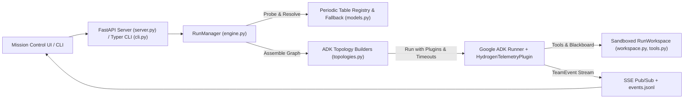
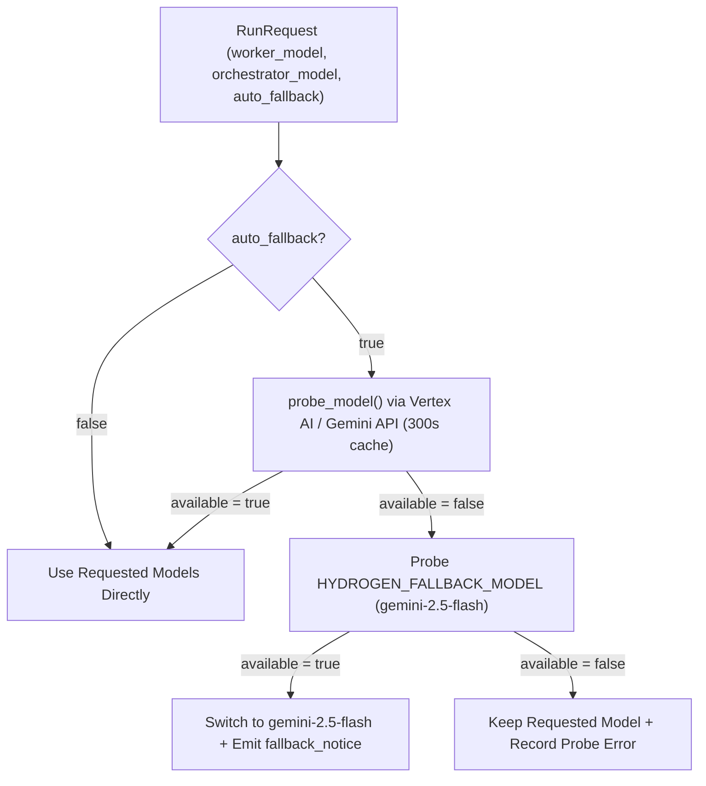
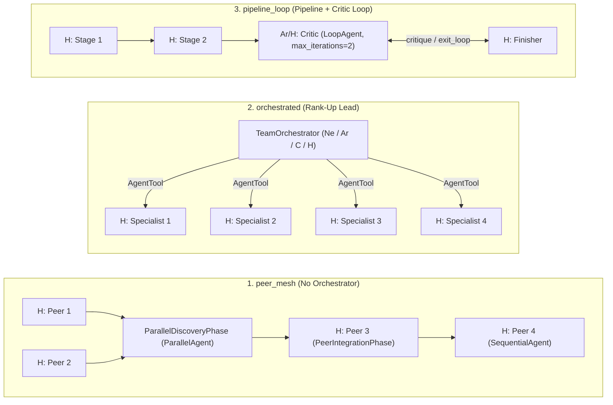
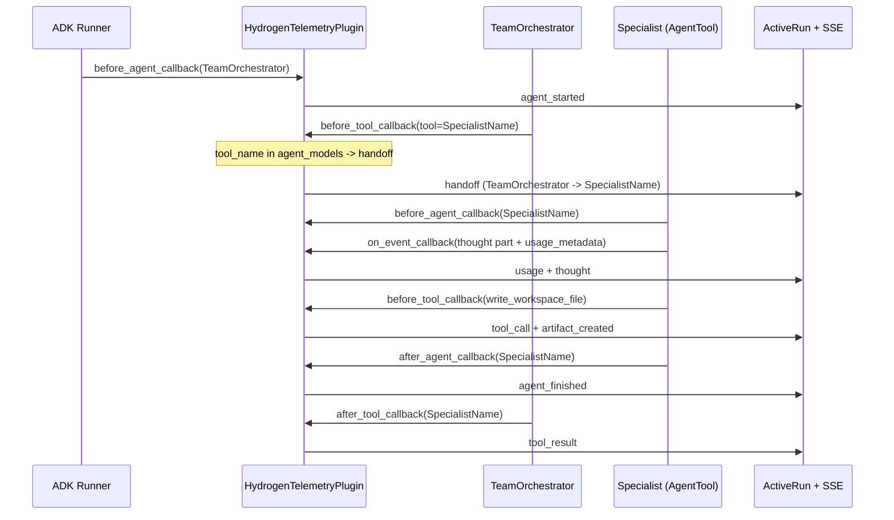
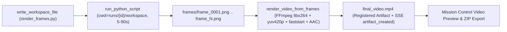

# Hydrogen Team Architecture

Hydrogen Team is a multi-agent collaboration engine built on **Google ADK** and the **Gemini 4 Periodic Table** model lineup. It coordinates specialized agents across a shared Team Blackboard and sandboxed per-run workspace while streaming real-time thinking traces, nested tool calls, and cost telemetry over Server-Sent Events (SSE).

---

## 1. System Overview

---

## 2. Gemini 4 Periodic Table Routing & Automatic Fallback

Model metadata, pricing, thinking capabilities, and availability probing live in [`src/hydrogen_team/models.py`](../src/hydrogen_team/models.py).

| Element | Model ID | Rank | Input / Output (per 1M) | Supported Thinking Levels | Typical Role |
| :--- | :--- | :--- | :---: | :--- | :--- |
| **1 `H`** | `gemini-4-hydrogen` | `worker` | `$1.50 / $7.50` | `MINIMAL`, `LOW`, `MEDIUM`, `HIGH`, `XHIGH` | Default high-throughput squad workers |
| **10 `Ne`** | `gemini-4-neon` | `orchestrator` | `$3.00 / $15.00` | `LOW`, `MEDIUM`, `HIGH`, `XHIGH` | Balanced frontier team lead |
| **18 `Ar`** | `gemini-4-argon` | `orchestrator` | `$2.00 / $10.00` | `LOW`, `MEDIUM`, `HIGH` | Token-efficient critic & orchestrator |
| **6 `C`** | `gemini-4-carbon` | `flagship` | `$2.00 / $10.00` | `LOW`, `MEDIUM`, `HIGH` | Deep flagship systems architect |
| **25 `Fl`** | `gemini-2.5-flash` | `fallback` | `$0.15 / $0.60` | `LOW`, `MEDIUM`, `HIGH` | Universal automatic fallback |

### Routing & Fallback Flow

1. **Zero-Key Auth Detection (`config.py`):** `Settings` checks for GCP Application Default Credentials (`vertex_adc` targeting `GOOGLE_CLOUD_LOCATION=global`) first, then `GEMINI_API_KEY` / `GOOGLE_API_KEY`.
2. **Pre-Flight Model Resolution (`resolve_model_with_fallback`):**
   - If `auto_fallback=True`, `RunManager` probes the requested `worker_model` and `orchestrator_model` using `_async_probe_model` (results cached in `_PROBE_CACHE` for `_PROBE_TTL_SECONDS = 300s`).
   - If a requested Gemini 4 model is unavailable or times out (20s probe timeout), it probes `HYDROGEN_FALLBACK_MODEL` (`gemini-2.5-flash`). If healthy, the run seamlessly re-routes to `gemini-2.5-flash` and emits a `fallback_notice` `TeamEvent`.
3. **Thinking Planner Adaptation (`build_thinking_planner`):**
   - For `gemini-4*` / `gemini-3*`, ADK `BuiltInPlanner` uses `types.ThinkingConfig(include_thoughts=True, thinking_level=...)`, clamped to the model's `thinking_levels`.
   - For Gemini 2.5 fallback models, it automatically maps `MINIMAL..XHIGH` to integer `thinking_budget` values (`512..8192`).
4. **Cost Accounting (`events.py`):** `RunTelemetry.record_usage()` bills `output_tokens + thoughts_tokens` at the model's output rate and tracks `estimated_savings_vs_neon_usd` against an all-Neon baseline.

---

## 3. Three Google ADK Collaboration Topologies

[`build_team_topology`](../src/hydrogen_team/topologies.py) constructs one of three Google ADK agent graphs from a `ScenarioSpec` (or user-defined `custom_agents`):

1. **`peer_mesh` (Decentralized Peer Collective):**
   - For >2 agents, wraps the first two independent peers in an ADK `ParallelAgent` (`ParallelDiscoveryPhase`), followed by the remaining integration/verification peers in an ADK `SequentialAgent` (`PeerIntegrationPhase`), all inside a root `SequentialAgent` (`HydrogenPeerMesh`).
   - For <=2 agents, builds a direct `SequentialAgent` (`HydrogenPeerCollective`). No central orchestrator is instantiated.
2. **`orchestrated` (Rank-Up Delegation):**
   - Instantiates `TeamOrchestrator` (`LlmAgent`) equipped with workspace/blackboard tools (excluding code/video/finance execution tools) plus each specialist wrapped in an ADK `AgentTool(agent=sub_agent)`.
   - `TeamOrchestrator` posts a kickoff proposal, delegates substantive execution to specialists in order, inspects `list_workspace_files` and `read_blackboard`, and synthesizes the final deliverable summary.
3. **`pipeline_loop` (Assembly Pipeline + Quality Gate):**
   - Runs front-stage agents sequentially inside `HydrogenPipelineLoop` (`SequentialAgent`), feeding into `QualityRefinementLoop` (`LoopAgent`, `max_iterations=2`) containing the critic (`blueprints[-2]`, optionally upgraded to `orchestrator_model`) and finisher (`blueprints[-1]`).
   - Both loop agents receive ADK's `exit_loop` tool so the critic can approve deliverables or request targeted revisions.

---

## 4. `HydrogenTelemetryPlugin` & Live Nested Observability

In ADK `orchestrated` mode, `AgentTool` executes sub-agents in isolated child invocations whose internal thoughts and tool calls do not automatically appear as top-level messages. [`HydrogenTelemetryPlugin`](../src/hydrogen_team/engine.py) extends Google ADK's `google.adk.plugins.BasePlugin` and attaches to `Runner(..., plugins=[plugin])` so every callback fires across both root and nested `AgentTool` invocations:

- **`before_agent_callback` / `after_agent_callback`:** Maps structural container agents (`HydrogenPeerMesh`, `ParallelDiscoveryPhase`, `PeerIntegrationPhase`, `QualityRefinementLoop`, etc.) to `phase_changed` events, and specialist/orchestrator turns to `agent_started` / `agent_finished`.
- **`before_tool_callback` / `after_tool_callback`:** Checks `tool_name in self.agent_models` to distinguish `AgentTool` delegations (`kind="handoff"`, populating `target_agent` for UI message beams) from workspace/execution tools (`kind="tool_call"` / `kind="tool_result"`).
- **`on_event_callback`:** Deduplicates ADK events by `event.id` (`_seen_event_ids`), records `usage_metadata` (`prompt_token_count`, `candidates_token_count`, `thoughts_token_count`) via `RunTelemetry.record_usage()`, splits `content.parts` by `part.thought` into `thought` vs `message` events, and forwards `error_message` as `kind="error"`.
- **Persistence & Streaming (`ActiveRun`):** Every `TeamEvent` receives a monotonic `seq`, is appended to `runs/<run_id>/events.jsonl`, and is pushed to subscribed `asyncio.Queue`s for SSE replay + live tailing.

---

## 5. HTTP & Run-Level Timeout Protection

To prevent stalled upstream LLM requests or runaway tool loops from hanging a run:

| Layer | Setting / Env Var | Default | Enforcement Mechanism |
| :--- | :--- | :---: | :--- |
| **Per-Call LLM HTTP Timeout** | `HYDROGEN_LLM_TIMEOUT_MS` | `60000` (60s) | Passed into `types.HttpOptions(timeout=llm_timeout_ms, retry_options=types.HttpRetryOptions(attempts=2))` on `GenerateContentConfig` for every specialist `LlmAgent`, `TeamOrchestrator` (covering nested `AgentTool` calls), and ADK `RunConfig`. |
| **Overall Run Deadline** | `HYDROGEN_RUN_TIMEOUT_SECONDS` | `240` (4m) | `RunManager._execute_run` wraps the `runner.run_async(...)` consumption loop in `asyncio.wait_for(..., timeout=self.settings.run_timeout_seconds)`. |
| **Turn Cap** | `HYDROGEN_MAX_LLM_CALLS` | `40` | Passed to ADK `RunConfig(max_llm_calls=...)`. |
| **Subprocess Bounds** | Tool parameters | 5–90s / 60s | `run_python_script` clamps `timeout_seconds` to `5..90`; `render_video_from_frames` enforces a `60s` FFmpeg timeout. |

When `asyncio.wait_for` raises `TimeoutError` (or any unhandled execution error occurs), `RunManager._execute_run` sets `summary.status = "failed"`, records `summary.error`, emits a `TeamEvent(kind="error")`, saves `metadata.json`, closes the ADK `Runner` in `finally`, and closes all SSE subscriber streams (`run.close_streams()`). In the Web UI, `App.tsx` displays a `role="alert"` `.banner-error` banner with `activeRun.error`.

---

## 6. Sandboxed Workspace & Code-First Video Pipeline

Each run operates in an isolated directory `runs/<run_id>/` managed by [`RunWorkspace`](../src/hydrogen_team/workspace.py) and [`create_workspace_toolset`](../src/hydrogen_team/tools.py):

- **Path Traversal Prevention (`resolve_safe_path`):** Normalizes relative paths and asserts `candidate.relative_to(self.workspace_dir)`, blocking any `..` or absolute path escapes out of `runs/<run_id>/workspace/`.
- **Team Blackboard (`post_to_blackboard` / `read_blackboard`):** Thread-safe structured coordination log (`proposal`, `finding`, `critique`, `decision`, `handoff`, `question`) persisted to `blackboard.json`.
- **Code-First Video & VFX Pipeline (`video_vfx`):**
  1. Agents write procedural animation scripts (Python + Pillow / NumPy / math) using `write_workspace_file`.
  2. `run_python_script` executes the script with `cwd=workspace_dir` and registers newly generated outputs (emitting `artifact_created` for deliverables and `frames/...0001.png` without flooding events for every intermediate frame).
  3. `render_video_from_frames` invokes `ffmpeg` to encode numbered PNG frames (`frames/frame_%04d.png`) into web-playable H.264 MP4 (`-c:v libx264 -pix_fmt yuv420p -movflags +faststart`), padding odd dimensions (`pad=ceil(iw/2)*2:ceil(ih/2)*2`) and optionally synthesizing a harmonic ambient AAC audio bed via `lavfi` `aevalsrc`.
  4. `RunWorkspace.build_zip_bundle()` packages `workspace/`, `blackboard.json`, and `metadata.json` for one-click download from Mission Control.

